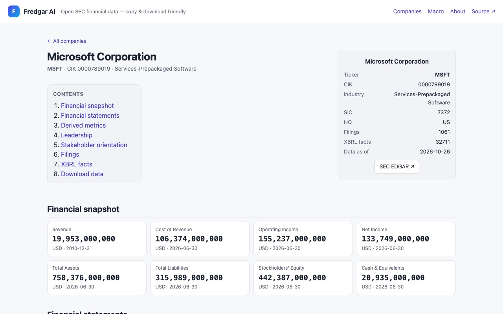
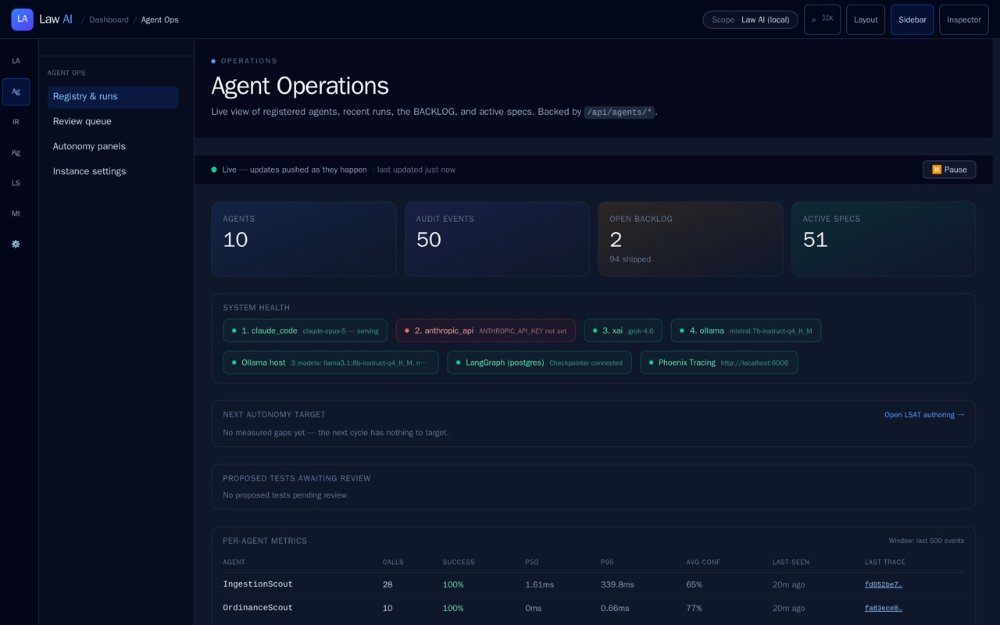
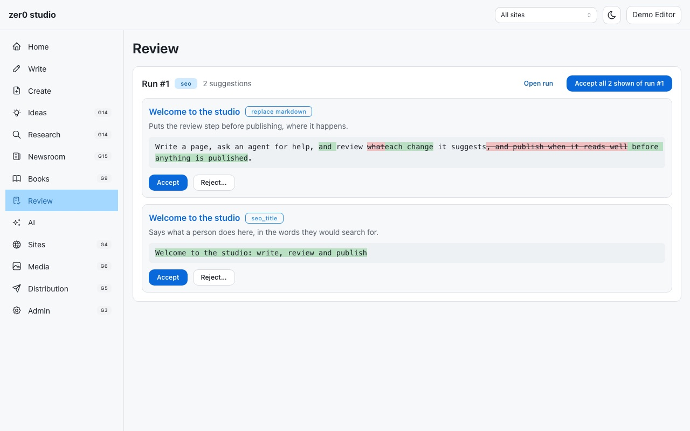
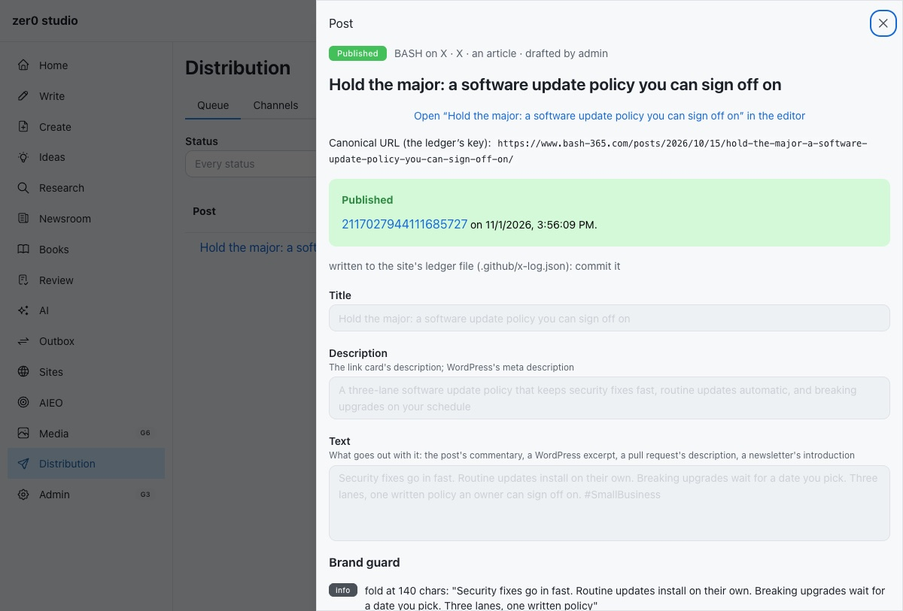
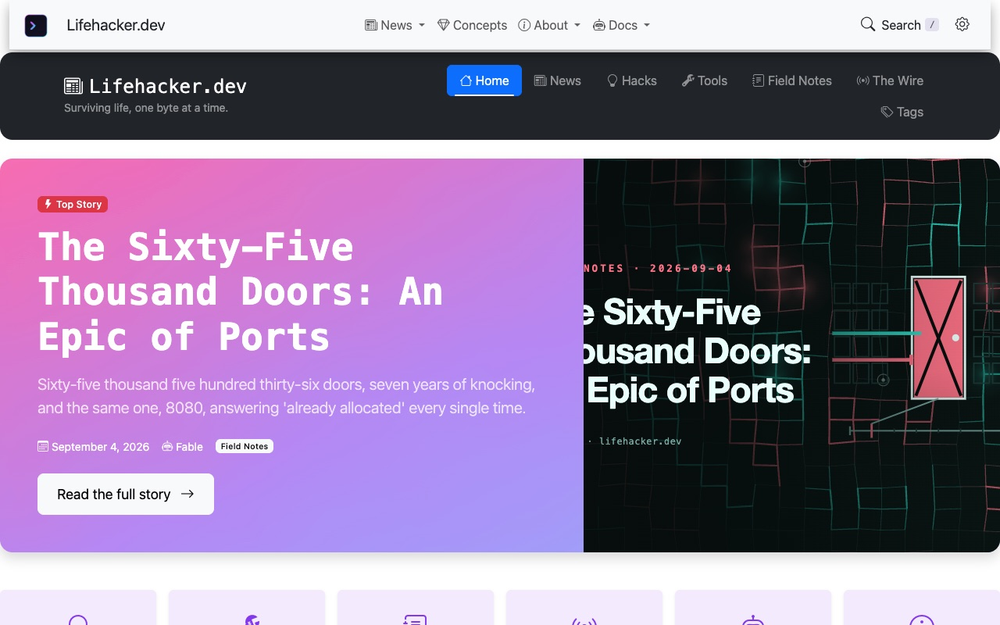
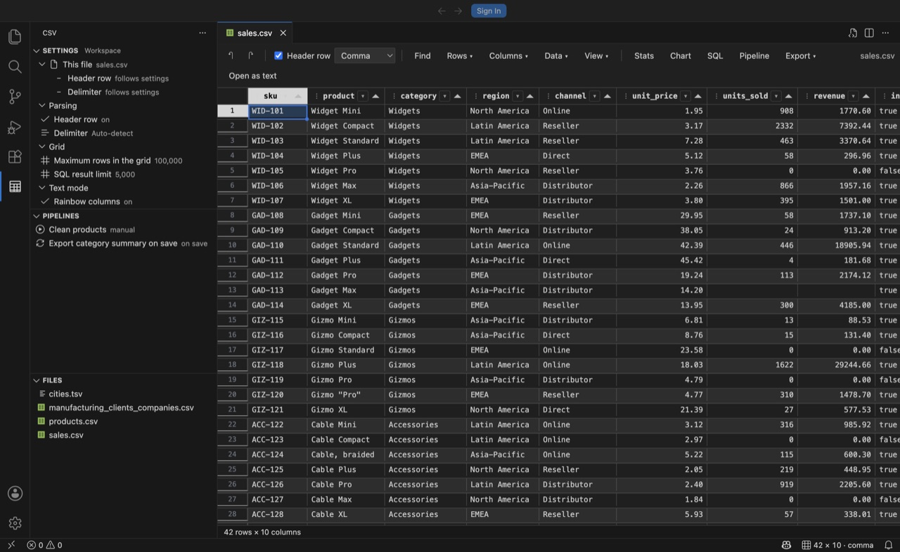

Three years ago this week, the noise stopped.

If you have worked in a large company, you know the noise. The weekly stand-up that never moves. The transformation roadmap with no roads on it. And the scariest sound in the building: an emergency meeting about the "cash flow imperative," called by leadership, attended by everyone with an opinion, and closed to the person holding the system design that fixed the cash problem the meeting was about.

That person was me. The meeting went ahead without the design, the way those meetings do. The verdict came down. Then a baby started crying, the real kind, and I went home to the best paternity leave in corporate history, approved by nobody. ([The short version of that story](https://bamr87.github.io/posts/2026/11/01/badwill-impairment/) is on my own site.)

This is the ledger of what one person and governed artificial intelligence (AI) built in the three years since. It is kept the way I was trained to keep a ledger: every entry has a source, and the entries that are still plans are booked as plans.

## Goodwill, badwill and the meeting I wasn't invited to

In accounting, goodwill is the premium a buyer pays over the fair value of everything it can count: the reputation, the relationships, the know-how that never fits on a balance sheet. When that premium turns out to be worth less than the price, the company writes it down. The write-down is a goodwill impairment, and it usually arrives with a press release about headwinds.

Badwill is the rarer opposite. It is negative goodwill, booked when a buyer gets a business for less than its assets are worth. Accountants call it a bargain purchase gain, and the standards make you check your math again before you are allowed to believe it.

Here is the corporate version of the trade, which no standard covers. A company decides that the people who understand both the ledger and the systems underneath it are a cost to be impaired, and books the savings as a gain. What walked out the door was know-how nobody had put on the books, sold at a bargain to whoever wanted it next. In my case, the buyer was me. I booked the badwill.

## What got built instead

Six entries. Every one is public, every one has a link, and every one is followed by the note an auditor would want.

### fredgar-ai: an analyst that reads the filing before the meeting

[fredgar-ai](https://github.com/bamr87/fredgar-ai) pulls company data from the U.S. Securities and Exchange Commission's (SEC) Electronic Data Gathering, Analysis, and Retrieval system (EDGAR), and optional macroeconomic series from Federal Reserve Economic Data (FRED), into a database of its own. It runs on Django with a React front end, uses SQLite until you point it at PostgreSQL, and caches what it pulls from the SEC first, to stay inside the SEC's fair-access limits. A versioned application programming interface (API) serves the data, and every Monday a workflow publishes [a static site of company financials](https://bamr87.github.io/fredgar-ai/) that needs no login.

It also shows you where the data is strange, which is more than most dashboards will admit. On Microsoft's page, the latest figure on the Revenue line is dated 2010, while everything beside it is from 2026. Filings tag their numbers in more than one way, and the page shows you the seam instead of hiding it. A system that puts the oddity on screen beats a meeting that discovers it in the fourth quarter.

*Auditor's note:* the README promises AI-written summaries. What exists today is an optional, administrator-only analysis of leadership language, grounded in filing excerpts and switched off unless someone supplies a model credential. The summaries are on the roadmap, which is where corporations keep them too.

### law-ai: a lawyer that keeps its prompts at home

[law-ai](https://github.com/bamr87/law-ai) is a legal research platform: Django and LangGraph agents working over a Neo4j graph of cases and the citations between them. It answers with Claude by default and falls back through xAI's Grok to Ollama, a model running on the same machine. One setting pins it to the local model, so nothing in a prompt leaves the building. Court opinions from CourtListener, Colorado statutes and the Denver municipal code land in a quarantine queue that a person approves before anything reaches the graph. A LegalBench harness grades its answers every night, and a regression fails the run.

*Auditor's note:* this one is an experiment. Its most quotable feature, a reviewer that cross-examines every pull request for license and compliance risk, is imported but not switched on. The lawyer has passed the bar in continuous integration (CI) and is waiting for its first case.

### zer0-CMS: the content system that never skips the approval

[zer0-CMS](https://github.com/bamr87/zer0-CMS) started as a fork of Front Matter CMS, a Visual Studio Code extension, and is no longer one. The extension was rewritten, and the platform was rebuilt on Django and Wagtail with a React studio in front. It runs on SQLite or PostgreSQL, ships as a container, and the Ruby on Rails content management system (CMS) it replaced is retired.

Its organizing idea is the one this practice sells. AI agents are users with permissions, not ghosts in the content. What an agent writes arrives as a suggestion, shown as a diff, and a person accepts or rejects it.

Publishing is off by default and runs through one fixed sequence (draft, brand guard, approval, publish, ledger), whether the target is a site, LinkedIn, X, WordPress or a newsletter. Here it is sending an earlier BASH post to X, with the note that it was written to the ledger that keeps it from going out twice.

*Auditor's note:* much of the README describes work in progress, and the repository's history includes the original Front Matter project's commits, which are not mine to count.

### lifehacker.dev: a newsroom with one robot and one editor

[lifehacker.dev](https://lifehacker.dev/) is a Jekyll site, 317 posts deep, written by Claude Code and published by a human. The robot opens pull requests. Branch protection and a code-owners file make a person approve every one, and a verification job rebuilds the site exactly as GitHub Pages will before it checks the front matter, the brand rules, the links and the drift. The brand is data: identity, voice and glossary in files the robot reads before it writes. Its news desk, The Wire, has a press charter this article has borrowed: satire in the framing, never the facts.

*Auditor's note:* every automated loop idles until its repository switch is turned on, and as of November 1, 2026, every switch is off. The robot is on leave. Unlike mine, its leave required a configuration change.

### CSV Grid Editor: the spreadsheet that stays a text file

[CSV Grid Editor](https://github.com/bash-365/csv-vscoode) opens comma-separated values (CSV) and tab-separated files in a spreadsheet grid inside Visual Studio Code, on top of the file itself. The text stays the source of truth, so save, undo and Git behave as usual, and nothing reformats your dates or drops your leading zeros on the way back out. It scrolls past 100,000 rows, filters columns the way Excel does, loads the file into an in-memory SQLite table you can query with Structured Query Language (SQL), and saves repeated cleanup as pipelines that can run every time you save.

*Auditor's note:* it is finished. Version 1.0.0 is on the Visual Studio Marketplace (443 installs as of November 1, 2026) and Open VSX (726 downloads), and the repository is archived. Finished is a status corporate project reports rarely offer. The usual options are on track, at risk and re-baselined.

### The control plane: forty-four repositories and no status meeting

The thing I most wanted to build inside a company was a control plane over everything I maintain. [bamr87/bamr87](https://github.com/bamr87/bamr87) is my GitHub profile repository, and it is that control plane. A registry lists 44 projects: 38 mounted as submodules, six hosted elsewhere, 21 of them active. The profile's project list is generated from that registry after every merge. A reconciler runs every morning, fixes renamed repositories and drifted links, and opens a pull request with the fix; a repository that has disappeared is filed as an issue, never deleted on a guess. A drift check runs on every pull request and fails it when the registry, the submodules and the folders disagree, or when someone hand-edits a generated file.

The agents work the way a good team does, minus the stand-up. A daily pipeline scans for problems, writes each one up with its evidence, implements a fix on a draft pull request and marks it ready for review. It never merges. A second agent opens draft fixes for failing workflows, and a third answers when someone mentions it. Releases are cut by release-please, a deterministic tool, because some things should not be creative.

All of it renders into [the Harness Console](https://bamr87.github.io/bamr87/), rebuilt from the repository every day: every project, its health, its AI harnesses and what they cost.

*Auditor's note:* the console is honest about the fleet, too. On the day this screenshot was taken it showed 20 projects needing attention and 6 failing workflows. And the parts of the pitch that sounded best (observability for every service, infrastructure reconciled from Git, a phone that watches the fleet) exist today as three repositories marked "foundation (phase 1)." In a corporation, those would be roadmap items. The difference is that these roadmap items have a README and a commit history.

## Why one person can do this now

None of this is a story about talent. It is a story about where the controls live.

A corporation manages risk with meetings: the stand-up, the steering committee, the change advisory board, and the emergency session about the cash flow imperative. Each one asks people to remember the rules and agree, again, that they still apply. Everything above manages risk with files and checks instead. The rules live in the repository. Recurring work runs from versioned playbooks. Automation checks every change before it ships and fails loudly when something is wrong. AI agents draft, open pull requests and report what they did, and a named person approves anything that leaves the building, the same way this site posts to LinkedIn ([[Automated LinkedIn posts, approved by a person]]). Deterministic tools carry the load, and the model is spent only where judgment is needed.

That is the whole trick, and it is the same one we use with clients. A small business does not need a large information technology (IT) department to run enterprise-grade systems. It needs the department's controls, written down, checked by machines and approved by a person who knows what the numbers mean.

## What your business can borrow

- **Turn one meeting into a check.** Pick the recurring meeting whose real job is to catch a mistake, and write the mistake down as a test, a lint rule or a checklist a script can run. Keep the meeting until the check has caught something twice.
- **Put the approval rules in a file.** Who may publish, merge, pay or delete belongs in one file under version control, read by people and machines alike.
- **Let agents propose, and keep the merge for a person.** Give AI the pull request and a person the merge button. The audit trail writes itself.
- **Keep a ledger of what went out.** Posts, payments, emails, deployments: if it can happen twice by accident, record it once on purpose.
- **Count the know-how before you impair it.** Before the next restructuring, list the people who understand both the ledger and the system underneath it. That list is the goodwill you are about to write down, and somebody else will book it as a bargain.

## Next step

If your business is holding the cash flow imperative meeting right now, bring the system design instead. We build enterprise-grade software and automation for small and mid-sized businesses, with the controls written down and a person approving every change: see [software development](/services/dev/).
